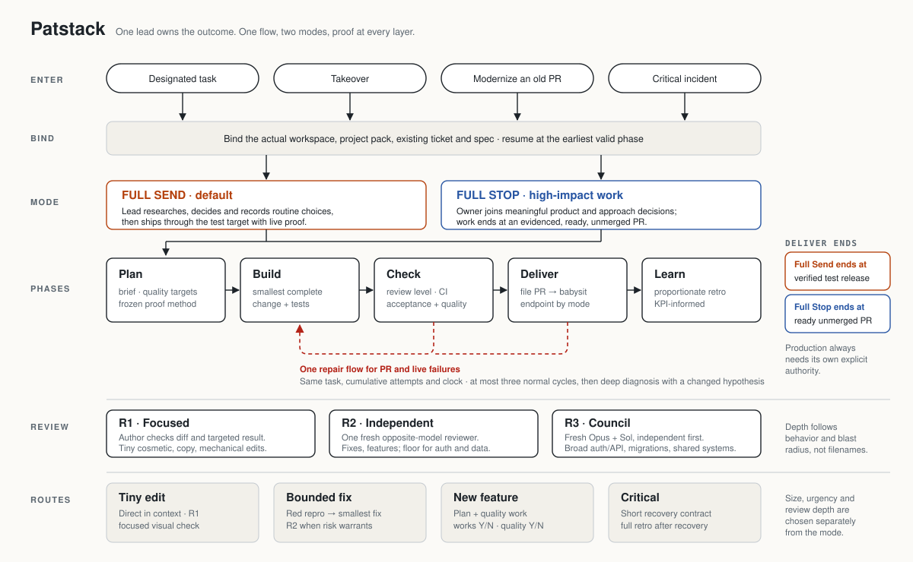
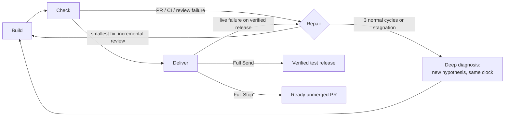

# Patstack

**One lead agent owns a development task from request to proof.** Patstack is a single workflow skill for Claude Code and Codex: it binds the real project, picks the smallest route that fully solves the task, chooses review depth by risk, and does not call work done until the agreed endpoint is proven. That endpoint is a verified test release (Full Send) or a ready, unmerged PR (Full Stop).

It ships as two skills plus a small private KPI recorder:

| Component | What it is |
|---|---|
| [`skills/patstack`](skills/patstack/SKILL.md) | The development workflow: modes, phases, review levels, repair loop, delivery, retro. One entrypoint with phase references loaded on demand. |
| [`skills/create-test-recipes`](skills/create-test-recipes/SKILL.md) | Generates and maintains a project's verification recipes so agents stop rediscovering how to test an app. Adapted from Poteto's pstack (MIT). |
| [`monitoring/patstack`](monitoring/patstack/README.md) | Standard-library Python recorder and reporter for private workflow KPIs. Includes a non-blocking lifecycle audit hook and unit tests. |



**Interactive walkthrough:** open [`docs/workflow.html`](docs/workflow.html) locally in a browser. It is self-contained, pausable, keyboard-operable and respects reduced-motion settings. GitHub shows HTML files as source, so clone or download the file to view it.

> **Status:** Patstack r5 is **installed** on the owner's Mac, Linux devbox and Windows hosts and **discovered** by fresh Claude Code and Codex sessions there, as reported by the owner. Installed and discoverable is not the same as proven end to end: Windows has no native task registry, Codex hook trust is unproven, and there is no unattended overnight guarantee. See [Status and limits](docs/status-and-limits.md) for what the owner reports and what this package verifies itself.

---

## What you say, what happens

Patstack has no slash commands. It triggers when a request designates development work. Phrases below are examples, not keywords.

| You say | Patstack does |
|---|---|
| "Make the save button use the brand colour" | **Tiny route.** Edits directly, checks R1 and the affected states, then ships through the PR and test target in Full Send. |
| "Fix the redirect loop after login" | **Bounded fix.** Builds a red reproduction, makes the smallest fix, and adds R2 review when risk warrants. |
| "Build CSV export for reports" | **New feature.** Writes a brief, derives quality targets, splits into slices only where useful, runs R2, delivers, and proves it live. |
| "Checkout is down" | **Critical route.** Writes a short recovery contract and chooses the fastest safe fix or mitigation. Runs the full retro after recovery. |
| "Full Stop: change how sessions are shared" | **Full Stop.** The owner joins meaningful decisions. Review is R3 where warranted, and work ends at a ready, unmerged PR. |
| "Take over PR #123" | **Takeover.** Reads what exists and verifies it rather than trusting it. Resumes at the earliest valid phase and keeps original credit. |
| "Is this old PR still worth it?" | **Modernize.** Checks the problem still exists before reviving it, or recommends closure with evidence. |
| "File a PR" / "Babysit it" | **Delivery steps** inside the same task. These are not separate orchestrators. |
| "We keep re-figuring out how to test this" | Runs **`create-test-recipes`**: writes project-local Launch / Doctor / Run / Evidence / Cleanup recipes. |
| "What do you think about X?" | **Nothing.** Discussion, research and casual testing create no development ticket. |

## Two modes

| | **Full Send** (default) | **Full Stop** |
|---|---|---|
| Who decides routine choices | The lead: it researches, picks the safest useful reversible option and records it | The lead for facts and routine details; the owner for meaningful product and approach decisions |
| Endpoint | Verified test release with live proof | Evidenced, ready, **unmerged** PR handed over |
| When | Every development task unless classified otherwise | Very large or important work touching sensitive auth or permissions, an important shared API, or broad customer-facing behavior |
| What does *not* switch modes | Uncertainty alone, two equivalent technical options | A cosmetic edit in a sensitive repo |

Size, urgency and review depth are separate choices from the mode. A Full Send grant covers the task's established test target and repair revisions. **Production always needs its own explicit authority.** [Mode rules →](skills/patstack/references/decisions.md)

## Phases

| Phase | Done when |
|---|---|
| **Plan** | Brief, relevant quality targets and the proof method are enough to implement. Accepted specs are reused, not rebuilt. |
| **Build** | The smallest complete candidate and its relevant tests exist. Work is parallelized only for ready, independent scopes with one owner each. |
| **Check** | The current candidate has the required review level, CI, and acceptance and quality evidence. |
| **Deliver** | Full Send: the intended test release works, with proof. Full Stop: the ready, unmerged PR is handed over. |
| **Learn** | Proportionate retro. Only justified, tested technical improvements are promoted. |

## Review levels

| Level | Who | Typical fit |
|---|---|---|
| **R1 Focused** | The author checks the diff and the targeted result. Labelled author review, never independent. | Trivial cosmetic, copy or mechanical edits |
| **R2 Independent** | One fresh opposite-model reviewer (Opus work → Sol, Sol work → Opus) | Behavior fixes and features. **Minimum** for auth, credentials, shell with user input, untrusted files, authenticated APIs, production databases, destructive operations and important API contracts. |
| **R3 Council** | Fresh Opus **and** Sol sessions judge independently first, then cross-examine | Broad auth/API changes, migrations, shared systems, unresolved material disagreement |

Depth follows behavior and blast radius, not filenames. A missing required reviewer is reported as missing. There is no silent downgrade. [Build and review rules →](skills/patstack/references/build-review.md)

## One repair flow for PR and live failures



Every failure records its layer, criterion, exact candidate or release, evidence and next action. Attempts and elapsed time carry across layers, PRs and models. Switching any of them does not reset the count. A merged PR is never reopened as a repair mechanism: fix-forward goes in a new linked PR on the same task. [Testing and delivery →](skills/patstack/references/testing-delivery.md)

## Quality proof, not scores

Every feature gets two verdicts: **"Feature works? Y/N"** and **"Meets the quality standard? Y/N"**. Evidence that is required but missing is reported as *not verified*. It is never counted as a Yes. Targets are derived by the agent before implementation and frozen; they are not retuned after results arrive.

| Task | Derived target and proof (examples from the [quality reference](skills/patstack/references/quality.md)) |
|---|---|
| New web page | Project budgets first. Where applicable, LCP ≤ 2.5 s, INP ≤ 200 ms, CLS ≤ 0.1 at p75 as initial field targets. Lab runs are proxies, not field proof. |
| New form or dialog | Existing components; keyboard completion; visible focus; contrast ≥ 4.5:1 for normal text; no horizontal overflow at supported widths |
| API or search endpoint | Before/after latency (median, p95), queries per request, payload, errors, and executed permission and leakage counterexamples on the same workload |
| Data change | Exact records, fields and permissions. Counts or sums alone prove nothing. |
| Tiny colour fix | Requested appearance and affected contrast, focus, hover and disabled states. No benchmark. |

These are engineering examples to derive per project, not universal thresholds. Patstack's own documents contain **no measured benchmark results**.

## Continuing other work

- **Takeover:** read the spec, PR, handoff, later corrections and current head. Check ownership and uncommitted work before writing. A handoff describes context, not correctness.
- **Modernize:** first ask whether the original problem still exists. A conflict-free rebase does not prove the PR is still relevant.
- **File PR → Babysit:** write a problem-first PR. Only the PR-owning lead watches it, through the native T3 PR watcher. A wake brings new state, and the latest head and checks are re-read before any readiness call.

Neither route grants force-push, merge, close or deploy rights.

## Specs live in GitHub, not in your repo

The canonical task spec goes in the **parent GitHub Issue body**. Delivery slices are native sub-issues, and dependencies use native blocking relationships. Nothing per task is committed to the application repository. There are no spec files, no planning folders, and no `.gitignore` churn. The lead hands each worker the Issue reference and spec version. If a worker cannot read it, the lead sends the content itself, because a path the worker cannot open is not a handoff. [Project context →](skills/patstack/references/project-context.md)

## Native, project and private layers

| Layer | Lives in | Published here? |
|---|---|---|
| Workflow (Patstack, create-test-recipes) | This repository | Yes |
| Native client capabilities (Claude/Codex system skills, plugins, Computer Use, browser tools) | The client's own managed locations | **No**. They are owned and updated by the client. Patstack uses them when the actual runtime exposes them. |
| Project packs (intake, auth, deploy and sync procedures, verification recipes) | Private, per project | **No**. See the sanitized [example project pack](examples/project-pack/README.md). |
| Host capability profile | `~/.config/patstack/devices.local.json`, mode 0600, per host | **No**. Only the [template](examples/devices.example.json). |
| Task registry, KPI database, telemetry, transcripts | Local state on each host | **No**. Only the [runtime contract](coordination/README.md). |

More in [docs/architecture.md](docs/architecture.md).

## Long runs and checkpoints

The lead keeps one compact record on the existing ticket: goal and spec version, completed criteria with evidence, candidate head/base/release, owners and child runs, the next concrete action, and cumulative attempts and time. It checkpoints at milestones, before compaction or handoff, and at least every 15 minutes. While waiting on CI or review, it ends only the current turn, and the native PR watcher wakes it. If no durable wake mechanism exists, it reports that gap; it does not pretend an idle chat will restart. Phases show up in native plans and checkpoints. **A T3 progress bar or taskbar phase display is a possible future UI integration and is not implemented.** [Task state →](skills/patstack/references/task-state.md)

## KPI monitoring

```bash
python3 monitoring/patstack/kpi_monitor.py record < examples/kpi-snapshot.example.json
python3 monitoring/patstack/kpi_monitor.py report
```

Snapshots are allowlisted metadata only: IDs, mode, status, timestamps, counts and node outcomes. They never hold prompts, transcripts or credentials. Missing labels stay *unknown*, never zero. The lifecycle hook records audit receipts (hashed session identity and event counts) and **does not** infer outcomes. Retro reads the report and then checks the underlying evidence. [KPI contract →](monitoring/patstack/README.md)

## Quick start

```bash
git clone <this repository> patstack && cd patstack
python3 scripts/check.py        # links, privacy scan, formats, KPI example, unit tests
```

Then follow [docs/setup.md](docs/setup.md) to expose the skills to Claude Code or Codex, add your host profile and optionally wire the audit hook.

## Repository map

```
skills/patstack/                 workflow entrypoint + phase references
skills/create-test-recipes/      recipe generator (MIT, Lauren Tan; see PROVENANCE.md)
monitoring/patstack/             KPI recorder, audit hook, installer, tests
coordination/README.md           task-registry runtime contract (implementation not included)
MODEL_RANKING.md                 model-routing contract (example)
examples/                        project pack, host profile and KPI snapshot templates
docs/                            setup, architecture, status, privacy, visuals
scripts/refresh_from_source.py   refresh published files from the private source
scripts/check.py                 package validation
SOURCE-MANIFEST.json             source and published SHA-256 per refreshed file
```

## Credits and license

Patstack borrows deliberately from [Theo's tstack](https://github.com/t3dotgg/tstack) (Full Send/Full Stop, council, file-PR, babysit, takeover, modernize), [Matt Pocock's skills](https://github.com/mattpocock/skills) (spec, tickets, implement-spec, retro), [Poteto's pstack](https://github.com/cursor/plugins/tree/main/pstack) (verification generator, benchmark and evaluation discipline), [Zeroshot's review loop](https://github.com/the-open-engine/zeroshot/blob/main/docs/guides/review-loop.md) and [Ponytail](https://github.com/DietrichGebert/ponytail). Those projects were read as design sources. Only `create-test-recipes` adapts upstream text, and it keeps its MIT notice. See [`sources.md`](skills/patstack/references/sources.md) and [NOTICE.md](NOTICE.md).

**No license has been selected for this repository as a whole.** See [NOTICE.md](NOTICE.md).
